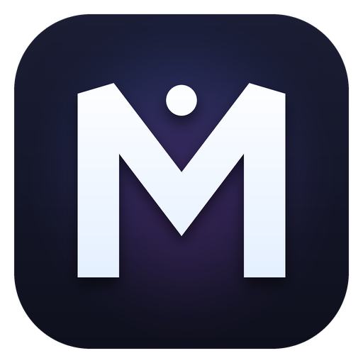

<div align="center">
  
  <h1>MELORA</h1>
  <p><strong>Version 1 — An open-source Android music player with a Liquid Glass interface, synced lyrics, and listening insights.</strong></p>
  <p>
    
    
    
  </p>
</div>

**MELORA** (`com.melora.music`) brings music discovery, streaming playback, synchronized word-level lyrics, and listening analytics together in one Android app built with Kotlin, Jetpack Compose, and Media3.

## Features

### Playback & Audio
- Stream music via InnerTube with queue management, sleep timer, playback speed, and equalizer support.
- Background playback with media notification, lock-screen, and Android Auto controls.
- Crossfade, AutoMix, and DJ-style song transitions.

### Lyrics & Visuals
- Multi-provider synchronized lyrics with word/syllable timing, translation, and romanization.
- Fixed active-line **Liquid Glass** capsule highlight and calibrated word glow.
- Customizable player themes, adaptive artwork colors, Liquid Glass surfaces, and **Make your own** DIY theme designer.

### Integrations & Analytics
- **Discord Rich Presence** activity status and **Last.fm** scrobbling.
- Redesigned **Stats** page with listening time overview, play counts, `#1 On Repeat` spotlight, and ranked track breakdowns.
- **Listen Together** party sessions and Spotify / Apple Music playlist import.

## Credits
- **Lead Developer:** ZIOLEX VT
- **Side Developer:** UTKARSH PRAJAPATI

## Project Structure

MELORA is a multi-module Gradle Android project:

| Path | Responsibility |
| --- | --- |
| `app/` | Android application (`com.melora.music`), screens, ViewModels, navigation, playback service, and persistence. |
| `hig/` | Shared Cupertino-style controls, theme primitives, accessibility helpers, and Liquid Glass utilities. |
| `innertube/` | InnerTube client and catalog models. |
| `lyrics/` | Lyrics providers, TTML/LRC parsing, romanization, and translation. |
| `canvas/` | Animated canvas artwork support. |
| `artwork/` | Artwork loading, caching, and blur processing. |
| `spotify/` | Spotify authentication and playlist import. |
| `integrations/` | Discord Rich Presence, Last.fm, and music recognition. |

## Build Locally

### Requirements
- JDK 21
- Android Studio with Android SDK 37 installed
- Android NDK (`27.0.12077973`) for native C++ analysis libraries

To build the compressed ARM64 release APK:

```bash
./gradlew :app:assembleArm64FossRelease
```

On Windows PowerShell:

```powershell
.\gradlew :app:assembleArm64FossRelease --console=plain
```

## Legal & License

MELORA is an independent project built upon open-source Convx foundations and is not affiliated with YouTube, Google, or their affiliates.

Licensed under the **GNU General Public License v3.0**. See [LICENSE](LICENSE) and [NOTICE](NOTICE) for full license and attribution details.
